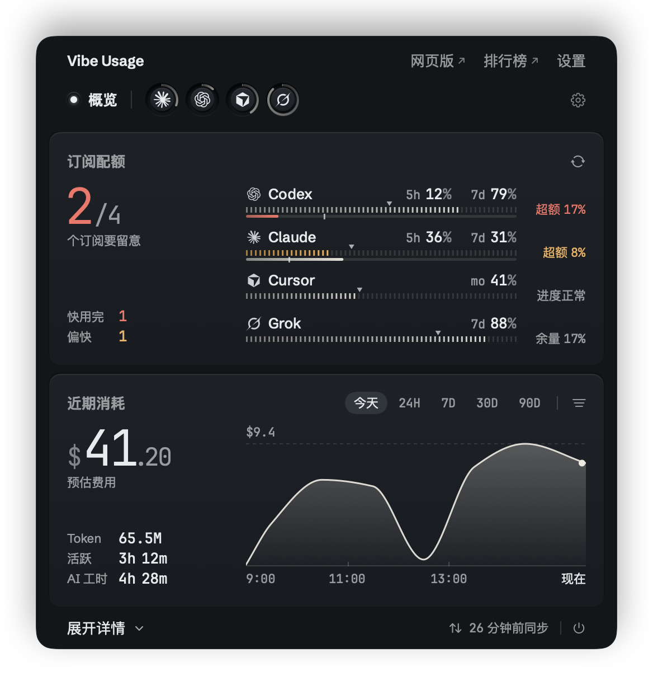
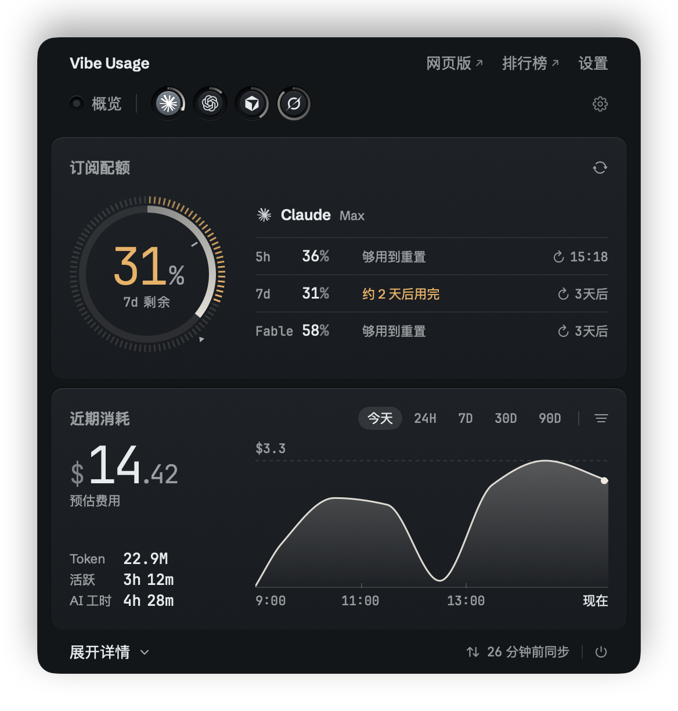

# Vibe Usage

macOS 应用，自动追踪 AI 编程工具的 Token 用量和费用。App 常驻菜单栏，可选显示在 Dock / Cmd-Tab。默认网页仪表盘位于 [vibefriends.com/usage](https://vibefriends.com/usage)。

<table align="center">
  <tr>
    <td></td>
    <td></td>
  </tr>
</table>

## 下载

从 [Releases](https://github.com/vibe-cafe/vibe-usage-app/releases/latest) 下载 `VibeUsage.dmg`，打开后将 `Vibe Usage.app` 拖入 Applications 文件夹。

## 配置

1. 打开 Vibe Usage，点击「登录并链接数据」
2. 浏览器自动打开审批页，默认站点为 vibefriends.com。使用自定义服务器时，在该服务器提供的审批页登录，核对验证码与 App 一致
3. 点击「确认链接」 — app 自动拿到 Key 并开始同步

## 功能

- 菜单栏常驻；可选显示在 Dock / Cmd-Tab，切换到 Vibe Usage 时自动打开用量面板
- 后台每 30 分钟自动同步数据，也可手动「更新数据」
- 弹出窗口显示费用、总 Token、缓存 Token、去重活跃时长和趋势图。面板与菜单栏的总 Token 和网页版一致，包含 5 分钟和 1 小时缓存写入。趋势图把缓存写入计入「输入」，「缓存」只统计读取。悬停活跃时长卡可看 AI 工时和平均同时运行的 AI 数量。悬停活跃趋势柱可看该时段的读数。
- **订阅配额监控**：自动识别 Codex、Claude、Kimi Code、ZCode、Grok、Cursor、Antigravity / AGY 和 OpenCode Go；面板顶部是一排产品图标 Tab（可拖动排序，最右侧一个齿轮图标进设置）：已生效排前面、彩色；已生效但取不到数据会多一个琥珀色小点，点它滑到卡片看原因；没生效的置灰排在后面、点它直接进设置。下方只展示已生效产品的卡片，一行两张、横向滑动；点 Tab 滑过去，滑动时高亮的 Tab 也会跟着走。全部关掉时整段只剩那一排图标。Codex、Claude 和 Kimi 复用各自本机官方客户端的登录状态；Claude 由本机 Claude Code 读取：App 只向它发查额度的控制请求，不传你的任何提示词，探测进程里遥测、错误报告、自动更新等由 App 主动设置的单项开关一律关闭；用官方订阅登录、设了代理变量时实测（Claude Code 2.1.330），只观察到连往 `api.anthropic.com` 的连接，按代码对应的常规请求是查额度（60 秒内有它自己的快照时不发）和每次启动都会发的启动配置；按代码，Claude Code 还可能：没设 `HTTP(S)_PROXY` 变量时向你配置的 API 地址预连接，账号资料缺失或超过一天时刷新，Team / Enterprise 账号读取远端托管设置和策略限制，符合条件的 Pro / Max 账号（个人订阅也算）在缓存缺失或超过一天时刷新邀请资格，登录过期时向 `platform.claude.com` 续期；Claude Code 配成 Bedrock / Vertex 等第三方服务时（这类登录没有订阅额度），它启动时为确认模型可用，可能用你的云账号向一个或多个模型各发一个固定的 `.`，每次最多 1 个输出 token，可能产生少量用量（和以前一样）；组织在托管设置里声明了额外的插件市场时，它可能连接其配置的地址；你或组织自己开启的 OpenTelemetry 导出、网关模型发现照原设置；组织策略只从服务端下发时 App 看不到，仍会启动 Claude Code，由它自己执行策略；Kimi 的短期 access token 由共享 CLI 通过标准 OAuth 自动、安全轮换。OpenCode Go 在 App 内原生读取 OpenCode 自己保存的登录：API Key，或 OpenCode 账号登录的访问令牌连同它选中的工作区（依次看 2.x 凭据表的 `opencode-go`、`opencode` 两项，再看 1.x 的 auth.json），调用官方 usage 接口展示 5 小时 / 每周 / 每月三个窗口；登录信息只作请求头，不落盘、不缓存、不写日志，不改写也不续期 OpenCode 的登录（账号登录过期时不发请求，打开一次 OpenCode 即自动续期）；没找到登录时卡片显示「在 OpenCode 里登录后自动显示」，未订阅 Go 的账号显示「未订阅 OpenCode Go」。ZCode 支持 BigModel（国内）与 Z.ai（海外），仅使用用户显式输入并按区域分别保存在 Vibe Usage 自有 Keychain 项中的 Coding Plan API Key。Grok 由同步工具（CLI）启动已安装、已登录的官方 `grok` 命令行，只查一次当前账期的百分比、周期和方案：不开对话、不发提示词、不耗额度，由 Grok 用它自己的登录向 xAI 查询（它启动时照常拉取自己的远程设置、模型列表，登录快过期时自己续期），App 和 CLI 都不读 Grok 的登录信息；没检测到代理时先做下面的出口检测。查不到或暂停时，改读官方 CLI 普通日志里结构化 billing 事件记下的上次额度，不保留其他日志字段。Cursor 复用客户端登录读取官方订阅额度与周期重置时间（新版 Cursor 加密了本机登录时，可在设置里单独登录 Cursor，见下一条）；Antigravity / AGY 通过已登录的官方 agy 读取各模型组的 5 小时与每周额度（Google 在论坛和常见问题里表示，个人版不支持第三方应用读取 agy 的额度）。只有选中的可读取产品才会启动读取或联网，未开启的产品不联网读取配额，配额只在本机显示；单个产品失败不影响另一张卡片
- Claude 的实时回复和本机缓存都从原始 `limits` 读取 Fable 等模型的每周额度，包括已用比例和可选的重置时间。来源标为每周的窗口按 7 天计算。列表中没有模型额度时即清空，只有整个字段缺失时，才沿用同一账号上次实时读取且尚未到重置时间的值。App 在内存中按邮箱和组织名核对账号，使用缓存核对时还要匹配账号 UUID。模型额度和账号比对结果均不写入 App 缓存或诊断，也不上传。
- 支持今天 / 24H / 7D / 30D / 90D / 自定义日期，以及终端 / 工具 / 模型 / 项目筛选。自定义日期按本地时区统计用量和活跃时长，包含首尾两天的全天。
- 可在菜单栏显示今日费用和 Token 数；菜单栏显示、开机自启动与 Dock 图标开关集中在「设置 → 常规」
- 可在订阅配额选择器和设置中选择、排序任意数量的产品；首次运行只自动选择已检测且可用的产品（Antigravity / AGY 除外，要自己打开；Google 表示不支持第三方读取额度），未选择的产品不显示也不读取
- 可在设置中为 Codex、Grok、Antigravity / AGY 添加多个 Multica 或其他隔离运行时目录（「设置 → 数据目录（高级）」）；旧版单一 Codex Home 配置和各工具默认目录仍会继续扫描
- 设置页按用途分组：同步账号与状态在最上面，然后是订阅配额选择（每个产品行带官方图标；点开 ZCode 行即可选择区域并填写 API Key，点开 Cursor 行可单独登录 Cursor）与常规开关，低频/高级项（数据来源说明与重新检测、额外扫描目录、更新、重置）收在折叠分组或页尾，功能没有任何删减
- **单独登录 Cursor**：Cursor 3.27 起会加密它保存在本机的登录，Vibe Usage 不解密，读不到时卡片显示「需要登录 Cursor」。在「设置 → 订阅配额 → Cursor」点「登录」，浏览器打开 cursor.com 的确认页（App 打开前核对地址就是 `https://cursor.com/loginDeepControl`），确认后 Vibe Usage 以 Cursor 命令行的身份登录，这份登录只用来读你的 Cursor 用量和额度；有的账号还要去邮箱点一次 Cursor 发来的确认链接。Cursor 没有开放第三方读取用量的接口，这种用法不在 Cursor 官方支持范围内。没被加密的用户什么都不用做，照旧读本机登录。登录存在 Vibe Usage 自己的钥匙串条目里，不读、不碰 Cursor 自己保存的任何东西；每次启动同步工具（CLI）时经标准输入交给它，不放进环境变量或命令行参数，不上传、不写日志和诊断。联网都由 CLI 发、都按你的代理设置走，走不了就不发：登录等待时每 2 秒查一次结果（`api2.cursor.sh`），最多 5 分钟；登录后读一次账号邮箱（`cursor.com`），只用来在设置里显示；离到期（约 60 天）不到 7 天时续期一次（`api2.cursor.sh`），也就是约每 53 天一次，续不上 6 小时后再试；读用量和额度的请求和以前一样。Cursor 不做下面的出口检测。设置里「退出」只删除 Vibe Usage 里的这份登录、不再用它发请求，Cursor 编辑器不受影响；Cursor 本机的登录还能读时，仍会照旧读取用量。Cursor 那边的这条登录要在 cursor.com 设置的 Sessions 里撤销：它显示为「Desktop App」，每续期一次多一条，撤销最多 10 分钟生效；正在用的 Cursor 编辑器也叫「Desktop App」，按时间分辨，别撤错。用 `npx` 装的命令行后台同步读不到钥匙串里的这份登录，它只认 `~/.vibe-usage/cursor-login.json`（在终端运行 `npx @vibe-cafe/vibe-usage login cursor` 生成）
- **同步上传的是统计数字**：按半小时汇总的 token 数、模型名、项目名、计算机名和会话时长，以及每 5 分钟里模型在输出的秒数（用来算活跃时长和「同一时刻有几个 AI 在干活」）；不含对话、命令和文件内容。关闭「上传项目名称」时，项目一律记为 unknown。
- **读取活跃时长**：链接账号后，面板读取用量或切换终端、工具、项目筛选时，会按系统代理设置，用 Vibe Usage 的 Key 向配置的服务器查询所选范围的去重时长和 AI 工时。模型筛选只影响费用和 Token。重置配置解绑后停止查询。
- **跟着你的代理**：App 自己的请求（Codex、OpenCode Go）按 macOS 系统代理（含 PAC）走；交给同步工具（CLI）和 Claude Code 的代理也按系统代理来，App 环境里已有代理变量时以它为准。系统代理只有 SOCKS 时，Claude Code（只支持 HTTP 代理）经 App 临时开的本机中转走代理：只听 `127.0.0.1` 的随机端口，只在这次查额度期间存在，要随机凭据，只放行 Anthropic / Claude 自家域名的 443 端口，不解开 TLS；上游 SOCKS5 要用户名密码时读不了 Claude 额度，不会改走直连。开机自启后，如果系统设了代理（含 PAC），有同步或配额要读时，App 每 2 秒试连一次代理端口（只建立连接，不发数据、不带账号），代理就绪或等满约 2 分钟后才同步和读配额；没设代理就不等。
- **出口检测**：要读 Codex、Claude、Grok、Antigravity 的额度、又没检测到代理时（系统代理没开、PAC 或 `NO_PROXY` 让它直连，或者代理在 TUN、路由器上本机看不到；Claude Code 自己 `settings.json` 里配的代理也算检测到），App 先用同一条线路、不带任何账号、Cookie 和令牌，访问一次该厂商地址的 `/cdn-cgi/trace`（Codex 用 `chatgpt.com`，Claude 用 Anthropic 的地址），只读其中的国家代码。出口在中国大陆、香港、澳门，或者确认不了，就暂停读取，卡片写明原因，下次读取时重新检测；出口在支持地区就照常读。同一地址 10 分钟内最多检测一次，暂停中每分钟最多一次，换了网络就重新检测。Grok 和 Antigravity 由同步工具（CLI）用同样的办法检测（Grok 用 `cli-chat-proxy.grok.com`；Google 的地址没有这个页面，Antigravity 用 `chatgpt.com` 代替，它要走代理而 Google 直连时改用 `api.anthropic.com`）。Cloudflare（这些厂商的 CDN）会看到你的出网 IP，但看不到账号。Cursor、Kimi、ZCode、OpenCode Go 不做这个检测。在设置 → 订阅配额 → 隐私保护 →「没检测到代理时」里三选一：「自动判断（推荐）」就是上面的做法；「暂停读取」是没检测到代理时一律暂停，不发检测请求；「照常读取」是不检测，直接读取。

## 系统要求

- macOS 14 (Sonoma) 或更高版本
- 不用另装 Node.js：App 自带官方 Node.js 24 运行同步工具（CLI）。自带的不能用时，会改用系统里的 [Node.js](https://nodejs.org)（v20+）或 [Bun](https://bun.sh)
- 从源码构建需要联网下载官方 Node.js（`scripts/fetch-node.sh`，按两份 SHA256 校验），以及系统里的 Node.js 和 npm（打包前检查 CLI 契约）

## 从源码构建

```bash
git clone https://github.com/vibe-cafe/vibe-usage-app.git
cd vibe-usage-app
./scripts/build-app.sh              # host architecture
./scripts/build-app.sh --universal  # arm64 + x86_64 (Intel + Apple Silicon)
./scripts/build-app.sh --external-test --cli-source ../vibe-usage --universal --notarize  # signed external test build
open "dist/Vibe Usage.app"
```

「设置 → 关于 → 复制诊断信息」只复制固定字段（版本、状态、固定原因等；能选界面样式的版本还带当前样式），已经脱敏，不含 Key、令牌、路径和账号，可以直接贴到群里；只在点按钮时生成，不上传、不写盘。

### 测试诊断（仅 Debug）

Debug 构建的设置页提供“导出诊断日志”入口。日志仅保存在当前 macOS 用户的 `~/Library/Logs/Vibe Usage/`，只记录结构化错误码、Provider、App/系统版本和配额 meter 数量，不记录 API Key、OAuth Token、请求头、响应正文、账号信息或本机路径。Release 构建会在编译期移除日志写入实现和导出入口。

维护者请参阅[发布与更换发布 Mac 指南](docs/RELEASING.md)，尤其是在另一台 Mac 上生成 Sparkle 更新之前迁移并校验当前签名密钥。

## 相关项目

- [@vibe-cafe/vibe-usage](https://github.com/vibe-cafe/vibe-usage) — 命令行同步工具
- [vibefriends.com/usage](https://vibefriends.com/usage) — Web 仪表盘

## License

[MIT](LICENSE)

### Cursor / AGY 配额接入的发布顺序

先合并并发布包含 `cursor` 与 `antigravity` 配额适配器的 CLI，再构建桌面版本；`scripts/check-cli.mjs` 会检查 npm `latest` 的实际能力，本地联调可使用 `--from-local ../cli`。不修改 CLI 自动更新策略、上传协议或已有用户选择；回滚桌面接线即可，配额数据不需要迁移。
